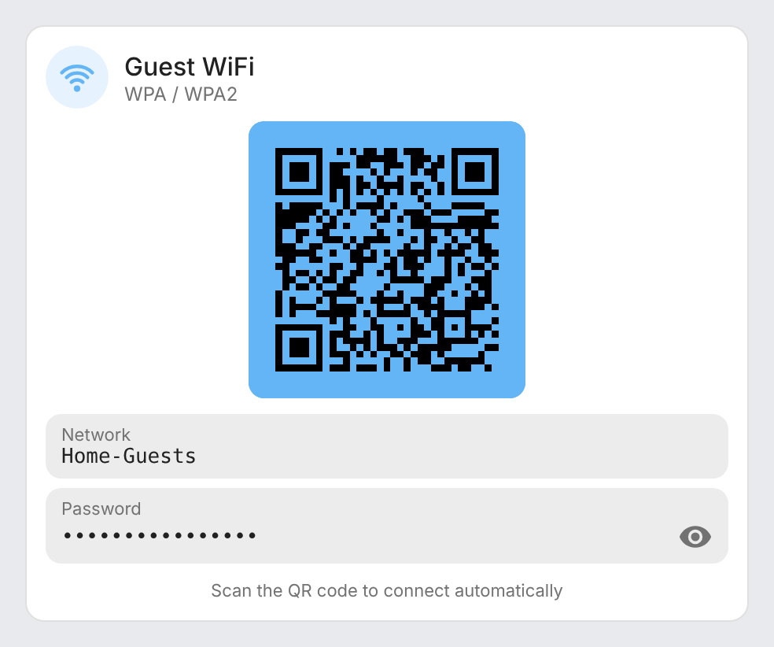
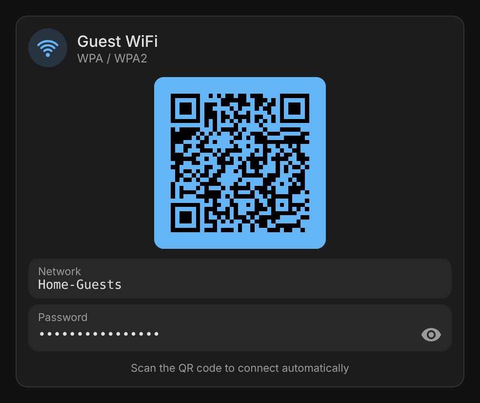

# ha-wifi-card

[](https://github.com/hacs/integration)
[](https://github.com/juju35/ha-wifi-card/actions/workflows/hacs.yml)
[](https://github.com/juju35/ha-wifi-card/actions/workflows/validate.yml)
[](https://github.com/juju35/ha-wifi-card/releases/latest)
[](LICENSE)

Custom Lovelace card for Home Assistant that displays a WiFi QR code for easy guest network access.

**Zero external dependencies** — the QR code is generated in pure JavaScript with an embedded Reed-Solomon encoder. No CDN, no network requests.

[](https://my.home-assistant.io/redirect/hacs_repository/?owner=juju35&repository=ha-wifi-card&category=plugin)


## Features

- QR code generated in pure JS (embedded Reed-Solomon algorithm)
- Password hidden by default, revealable with a toggle button
- Visual editor in the dashboard UI (no YAML needed)
- Light and dark mode, English and French
- HACS-ready
- Single file, lightweight (~24 KB)

## Prerequisites

Home Assistant 2024.8 or later. The card needs no integration, only the name and password of your network.

## Installation

### Via HACS (recommended)

Click the button below to add the repository directly:

[](https://my.home-assistant.io/redirect/hacs_repository/?owner=juju35&repository=ha-wifi-card&category=plugin)

Or manually:

1. Open HACS → **Frontend** → **⋮** → **Custom repositories**
2. Add `https://github.com/juju35/ha-wifi-card` — Type: **Dashboard**
3. Search for **Wifi QR Card** and install it
4. Clear your browser cache and refresh

### Manual

1. Download `wifi-card.js` from the [latest release](https://github.com/juju35/ha-wifi-card/releases/latest)
2. Copy it to `/config/www/wifi-card.js`
3. Go to **Settings → Dashboards → Resources** → Add resource:
   - URL: `/local/wifi-card.js`
   - Type: **JavaScript Module**
4. Clear your browser cache and refresh

## Configuration

### Visual editor

Add the card from the dashboard (**Add card → Wifi QR Card**) and fill in the fields: title, logo, SSID, password, security, QR code size and language. The preview updates live, and empty optional fields are left out of the generated YAML.

### Minimal

```yaml
type: custom:wifi-qr-card
ssid: MyNetwork-Guest
password: MySecretPassword
```

### Full options

```yaml
type: custom:wifi-qr-card
title: Wifi invité
logo: true
ssid: MyNetwork-Guest
password: MySecretPassword
security: WPA
qr_size: 176
```

### Options reference

| Option | Required | Default | Description |
|---|---|---|---|
| `ssid` | ✅ | — | WiFi network name (SSID) |
| `password` | ✅* | — | WiFi password (*not needed when `security: nopass`). Quote it in YAML when it is made of digits (`password: "01234567"`), otherwise YAML reads it as a number and drops leading zeros |
| `security` | ❌ | `WPA` | Security type: `WPA` (WPA/WPA2), `SAE` (WPA3), `WEP`, or `nopass` (open network) |
| `title` | ❌ | Auto (i18n) | Card title |
| `logo` | ❌ | `true` | Show the WiFi logo in the header badge (`false` shows the `mdi:wifi` icon instead) |
| `qr_size` | ❌ | `176` | QR code size in pixels (quiet zone included) |
| `language` | ❌ | Auto | Force language: `fr` or `en` (auto-detects from HA settings) |

## Screenshots

| Light | Dark (French) |
|---|---|
|  |  |

## How it works

The card generates a [WiFi QR code](https://en.wikipedia.org/wiki/QR_code#Joining_a_Wi-Fi_network) using the standard `WIFI:T:<security>;S:<ssid>;P:<password>;;` format. When scanned with a phone camera, the device automatically prompts to join the network — no need to type the password manually.

The characters reserved by this format (`\`, `;`, `,`, `:` and `"`) are escaped with a backslash in the SSID and the password of the QR code, so any network name or password can be used as is. The card itself shows them unescaped.

The password is stored in clear text in the dashboard configuration, which every Home Assistant user can read: use it for a guest network.

The QR code engine is a self-contained JavaScript implementation of the QR code specification (ISO/IEC 18004), including Reed-Solomon error correction, embedded directly in the card source. No external libraries or CDN requests are needed.

## Development

```bash
npm install
npm run build        # stamps the version of package.json into dist/wifi-card.js
npm run check        # builds and checks the card (run in CI)
npm run screenshots  # renders the card into screenshots/
```

`dist/` is not committed: `npm run build` creates it locally, CI builds it on every push, and the release workflow attaches the built file to the release, which is where HACS downloads it from.

### Releasing

1. Bump `version` in `package.json`
2. Add a `## <version>` section at the top of [CHANGELOG.md](CHANGELOG.md)
3. Push to `main`: the **Release** workflow builds the card, creates the tag and the GitHub release with the changelog section as notes, and attaches `wifi-card.js`

## Translations

The card auto-detects the language from your Home Assistant settings. Currently supported:

| Language | Code |
|---|---|
| English | `en` |
| Français | `fr` |

To force a specific language:

```yaml
type: custom:wifi-qr-card
ssid: MyNetwork-Guest
password: MySecretPassword
language: en
```

Contributions for additional languages are welcome!

## License

[MIT](LICENSE)
