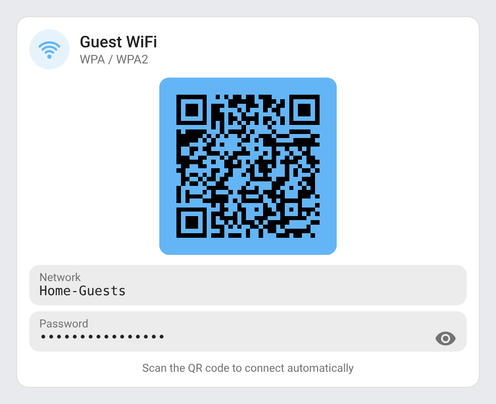
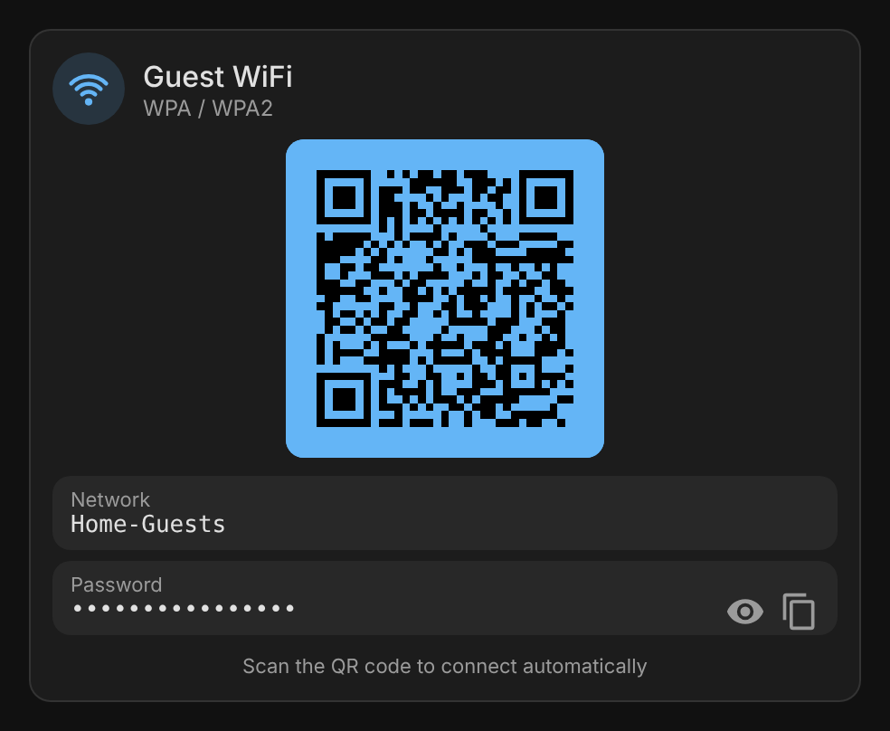
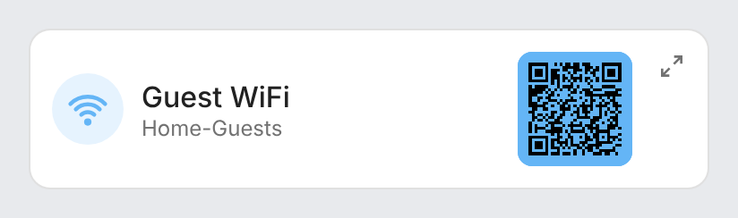
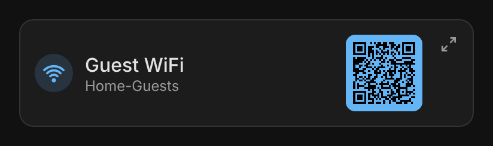
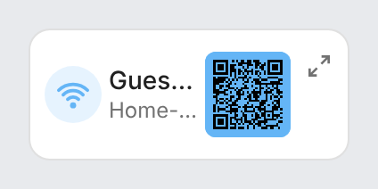
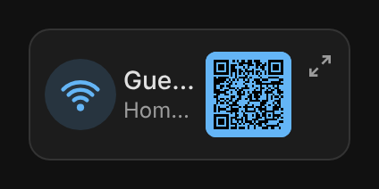

# ha-wifi-card

[](https://www.home-assistant.io/integrations/marketplace/)
[](https://github.com/juju35/ha-wifi-card/actions/workflows/hacs.yml)
[](https://github.com/juju35/ha-wifi-card/actions/workflows/validate.yml)
[](https://github.com/juju35/ha-wifi-card/actions/workflows/lint.yml)
[](https://github.com/juju35/ha-wifi-card/releases/latest)
[](https://github.com/juju35/ha-wifi-card/blob/main/LICENSE)
[](https://buymeacoffee.com/julienstep9)

Custom Lovelace card for Home Assistant that displays a WiFi QR code for easy guest network access.

**Zero external dependencies** — the QR code is generated in pure JavaScript with an embedded Reed-Solomon encoder. No CDN, no network requests.

[](https://my.home-assistant.io/redirect/marketplace_repository/?owner=juju35&repository=ha-wifi-card&category=plugin)



## Features

- QR code generated in pure JS (embedded Reed-Solomon algorithm)
- Password hidden by default, revealable with a toggle button (masked again after 30 s or when the card leaves the page), and a button to copy it to the clipboard
- Mini card (`wifi-qr-mini-card`): one compact row with the network name and a QR code thumbnail that opens the QR code full screen, and a detail button that switches to the full card and back
- Visual editor in the dashboard UI (no YAML needed)
- Light and dark mode, English, French, German, Spanish, Serbian (Cyrillic and Latin), Italian, Dutch, European Portuguese, Polish, Romanian, Danish, Swedish, Bulgarian, Russian, Ukrainian, Hungarian, Slovak, Czech, Slovenian, Latvian and Greek
- Ready for the Marketplace
- Single file, lightweight (~77 KB)

## Prerequisites

Home Assistant 2024.8 or later. The card needs no integration, only the name and password of your network.

## Installation

### Via the Marketplace (recommended)

Click the button below to add the repository directly:

[](https://my.home-assistant.io/redirect/marketplace_repository/?owner=juju35&repository=ha-wifi-card&category=plugin)

Or manually:

1. Open **Settings → Marketplace → Add from link** (top right; this needs a GitHub account connected)
2. Add `https://github.com/juju35/ha-wifi-card` — Type: **Dashboard**
3. Open **Wifi QR Card** and click **Install**
4. Clear your browser cache and refresh

### Manual

1. Download `wifi-card.js` and the `wifi-card.i18n.*.js` translation files from the [latest release](https://github.com/juju35/ha-wifi-card/releases/latest)
2. Copy them all to `/config/www/` (without the translation files, the cards show in English)
3. Go to **Settings → Dashboards → Resources** → Add resource:
   - URL: `/local/wifi-card.js`
   - Type: **JavaScript Module**
4. Clear your browser cache and refresh

## Configuration

### Visual editor

Add the card from the dashboard (**Add card → Wifi QR Card**, or **Wifi QR Mini Card** for the compact version) and fill in the fields: title, logo, SSID, password (or the entities giving them), hidden network, security, QR code size and language (plus the detail button for the mini card). The preview updates live, and empty optional fields are left out of the generated YAML.

### Minimal

```yaml
type: custom:wifi-qr-card
ssid: MyNetwork-Guest
password: MySecretPassword
```

### Full options

```yaml
type: custom:wifi-qr-card
title: Guest WiFi
logo: true
ssid: MyNetwork-Guest
password: MySecretPassword
security: WPA
qr_size: 176
```

### SSID and password from entities

`ssid_entity` and `password_entity` read the network name and the password from an entity's state, for example an `input_text` helper or the guest WiFi sensor of a router integration. The QR code and the texts update live when the state changes (a rotated guest password, say). While an entity is unknown or unavailable the card uses `ssid` / `password` if they are set; with no value at all it names the entity instead of showing a QR code.

```yaml
type: custom:wifi-qr-card
ssid_entity: input_text.guest_wifi_ssid
password_entity: sensor.router_guest_wifi_password
hidden: true
```

### Mini card

`wifi-qr-mini-card` takes the same options and shows the network on one compact row: the header icon, the title, the network name and a small QR code. The password is never shown. Tap the QR code thumbnail to open it full screen, like the big one of the full card. The detail button (top right) switches to the full card; the button or a click anywhere outside the card brings the compact view back.

```yaml
type: custom:wifi-qr-mini-card
title: Guest WiFi
ssid: MyNetwork-Guest
password: MySecretPassword
zoom: true
```

### Options reference

| Option | Required | Default | Description |
|---|---|---|---|
| `ssid` | ✅* | — | WiFi network name (SSID) (*not needed with `ssid_entity`) |
| `password` | ✅* | — | WiFi password (*not needed when `security: nopass` or with `password_entity`). Quote it in YAML when it is made of digits (`password: "01234567"`), otherwise YAML reads it as a number and drops leading zeros |
| `ssid_entity` | ❌ | — | Entity whose state is the network name (`input_text`, `text`, a router integration's `sensor`…). Overrides `ssid`, which stays the fallback while the entity is unknown or unavailable |
| `password_entity` | ❌ | — | Entity whose state is the password. Overrides `password`, which stays the fallback while the entity is unknown or unavailable |
| `hidden` | ❌ | `false` | The network does not broadcast its SSID: adds `H:true;` to the QR code so phones join it anyway |
| `security` | ❌ | `WPA` | Security type: `WPA` (WPA/WPA2), `SAE` (WPA3), `WEP`, or `nopass` (open network) |
| `title` | ❌ | Auto (i18n) | Card title |
| `show_title` | ❌ | `true` | Show the title in the header (e.g. `false` under a section heading of your own) |
| `show_subtitle` | ❌ | `true` | Show the subtitle under the title |
| `logo` | ❌ | `true` | Show the WiFi logo in the header badge (`false` shows the `mdi:wifi` icon instead) |
| `qr_size` | ❌ | `176` | QR code size in pixels (quiet zone included) |
| `zoom` | ❌ | `true` | Mini card only: show the detail button that switches to the full card and back |
| `language` | ❌ | Auto | Force language: `en`, `fr`, `de`, `es`, `sr`, `sr-Latn`, `it`, `nl`, `pt`, `pl`, `ro`, `da`, `sv`, `bg`, `ru`, `uk`, `hu`, `sk`, `cs`, `sl`, `lv` or `el` (auto-detects from HA settings) |

## Screenshots

| Light | Dark |
|---|---|
|  |  |
|  |  |
|  |  |

The mini card on a desktop column, then on 6 columns of a phone, where the QR code thumbnail gets smaller.

## How it works

The card generates a [WiFi QR code](https://en.wikipedia.org/wiki/QR_code#Joining_a_Wi-Fi_network) using the standard `WIFI:T:<security>;S:<ssid>;P:<password>;;` format (`WIFI:T:<security>;S:<ssid>;P:<password>;H:true;;` for a hidden network). When scanned with a phone camera, the device automatically prompts to join the network — no need to type the password manually.

The characters reserved by this format (`\`, `;`, `,`, `:` and `"`) are escaped with a backslash in the SSID and the password of the QR code, so any network name or password can be used as is. The card itself shows them unescaped.

The password is stored in clear text in the dashboard configuration, which every Home Assistant user can read: use it for a guest network. With `password_entity` it is not in the dashboard, but the entity's state is readable by every Home Assistant user too.

The QR code engine is a self-contained JavaScript implementation of the QR code specification (ISO/IEC 18004), including Reed-Solomon error correction, embedded directly in the card source. No external libraries or CDN requests are needed.

## Development

```bash
npm install
npm run build        # stamps the version of package.json into dist/wifi-card.js
npm run check        # builds and checks the card (run in CI)
npm run screenshots  # renders the card into screenshots/ (a PNG is rewritten only if its pixels change)
```

`dist/` is not committed: `npm run build` creates it locally, CI builds it on every push, and the release workflow attaches the built file to the release, which is where the Marketplace installs it from.

### Releasing

1. Bump `version` in `package.json`
2. Add a `## <version>` section at the top of [CHANGELOG.md](https://github.com/juju35/ha-wifi-card/blob/main/CHANGELOG.md)
3. Push to `main`: the **Release** workflow builds the card, creates the tag and the GitHub release with the changelog section as notes, and attaches `wifi-card.js`

## Translations

The card auto-detects the language from your Home Assistant settings: the full locale when it is translated (`sr-Latn`), otherwise its base language (`fr-FR` → `fr`, `pt-BR` → `pt`, European Portuguese), otherwise English. Currently supported:

| Language | Code |
|---|---|
| English | `en` |
| Français | `fr` |
| Deutsch | `de` |
| Español | `es` |
| Српски | `sr` |
| Srpski (latinica) | `sr-Latn` |
| Italiano | `it` |
| Nederlands | `nl` |
| Português (Portugal) | `pt` |
| Polski | `pl` |
| Română | `ro` |
| Dansk | `da` |
| Svenska | `sv` |
| Български | `bg` |
| Русский | `ru` |
| Українська | `uk` |
| Magyar | `hu` |
| Slovenčina | `sk` |
| Čeština | `cs` |
| Slovenščina | `sl` |
| Latviešu | `lv` |
| Ελληνικά | `el` |

To force a specific language:

```yaml
type: custom:wifi-qr-card
ssid: MyNetwork-Guest
password: MySecretPassword
language: en
```

Contributions for additional languages are welcome!

## License

[MIT](https://github.com/juju35/ha-wifi-card/blob/main/LICENSE)

## Support

If you find this project useful, you can support its development:

<a href="https://buymeacoffee.com/julienstep9"></a>
